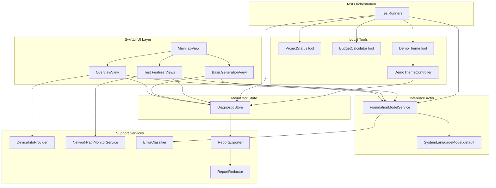

# Architecture

AFM3Tester is a native SwiftUI application that exercises Apple’s public **FoundationModels** framework on supported physical iPhones. The codebase is organized around a small set of services, deterministic test runners, and tab-based feature views.

## High-level structure



## UI layers

| Component | Role |
| --- | --- |
| `AFM3TesterApp` | App entry point |
| `MainTabView` | Tab shell wiring all diagnostic sections |
| `OverviewView` | Device/model metadata, copy report, run-all |
| `BasicGenerationView` | Interactive prompt runner with streaming and metrics |
| `TestFeatureViews.swift` | Structured, tools, memory, multilingual, safety, context, concurrency, benchmark, offline, errors, export |
| `DiagnosticUIComponents.swift` | Shared result cards, latency views, layout helpers |

All views are `@MainActor` SwiftUI. Long-running inference is launched with `Task` and reads results back on the main actor.

## Model and inference service

`FoundationModelService` is an **actor** that wraps `SystemLanguageModel.default`.

Responsibilities:

- Session creation and transcript rehydration
- Non-streaming `respond(to:options:)`
- Streaming `streamResponse` with cancellation checks
- Guided generation via `respond(generating:)`
- Optional `tokenCount(for:)` when available in the SDK
- Success and error recording through `DiagnosticRecording`

The service never fabricates model metadata. It reports `SystemLanguageModel.default` and on-device deployment only.

## Test orchestration

`TestRunners` contains `@MainActor` static runners for each automated suite:

- Structured output
- Conversation memory
- Tool calling
- Multilingual
- Safety observations
- Context window
- Concurrency
- Benchmark
- Offline verification

Each runner distinguishes:

- **Unavailable** — model/assets not ready
- **Failed** — test logic or inference failure on an available model
- **Observation** — behavioral notes, not pass/fail certification

## Tool definitions

Three local tools implement the `Tool` protocol:

| Tool | Type | Behavior |
| --- | --- | --- |
| `getProjectStatus` | Read-only | Deterministic status for fictional projects |
| `calculateBudget` | Read-only | Deterministic totals from line items |
| `setDemoTheme` | Side effect | Updates local demo appearance only when permitted |

Tool arguments use `@Generable` structs defined in `GenerableTypes.swift`.

## Permission gating

Side-effect tools are gated by `DemoThemeController.allowSideEffects`, mirrored in `DiagnosticStore.allowSideEffectTools`.

- Read-only tools may run during normal tests.
- Side-effect tools require explicit user intent in the UI.
- Quoted or retrieved text does not grant permission.
- Invalid arguments are rejected deterministically in tool code.

## Diagnostic logging

`DiagnosticStore` holds:

- `testResults`
- `errorLog`
- `benchmarks`
- `toolInvocationLog`
- `lastSuccessfulInference`

`ErrorClassifier` maps framework and policy errors into categories such as context limit, rate limit, cancellation, guardrail, and tool failure.

## Report export and redaction

`ReportExporter` builds a `DiagnosticReport` from live store and device snapshot data, then exports JSON or Markdown.

`ReportRedactor` removes common email, phone, and credential-like patterns unless the user explicitly opts in to include prompt text.

## Network-path monitoring

`NetworkPathMonitorService` uses `NWPathMonitor` to detect whether any network path is satisfied. Offline tests require a manual Airplane Mode workflow and a satisfied “offline” state before running.

The app does not toggle Airplane Mode and does not perform hidden network requests.

## Embedded unit self-tests

`EmbeddedUnitTests.swift` provides Debug-only self-tests for:

- Report redaction
- Validation helpers
- Deterministic tool outputs
- Side-effect permission gating

These run from the Overview tab and do not invoke the on-device model.

## Concurrency model

- Swift 6 strict concurrency is enabled project-wide.
- UI and store state live on `@MainActor`.
- Inference runs through the `FoundationModelService` actor.
- `DemoThemeController` is an actor guarding theme side effects.
- `NetworkPathMonitorService` is an actor wrapping path updates.

## Source layout

```text
AFM3Tester/
├── AFM3TesterApp.swift
├── App/
├── Core/
│   ├── Models/
│   ├── Services/
│   └── Tools/
├── Features/
│   ├── BasicGeneration/
│   ├── Overview/
│   ├── Shared/
│   └── Tests/
└── Resources/
```

## Non-goals

AFM3Tester is not a production AI app, analytics platform, or model hosting service. It does not certify security, compliance, or Apple Intelligence availability for any region or device beyond the observations recorded in test exports.
